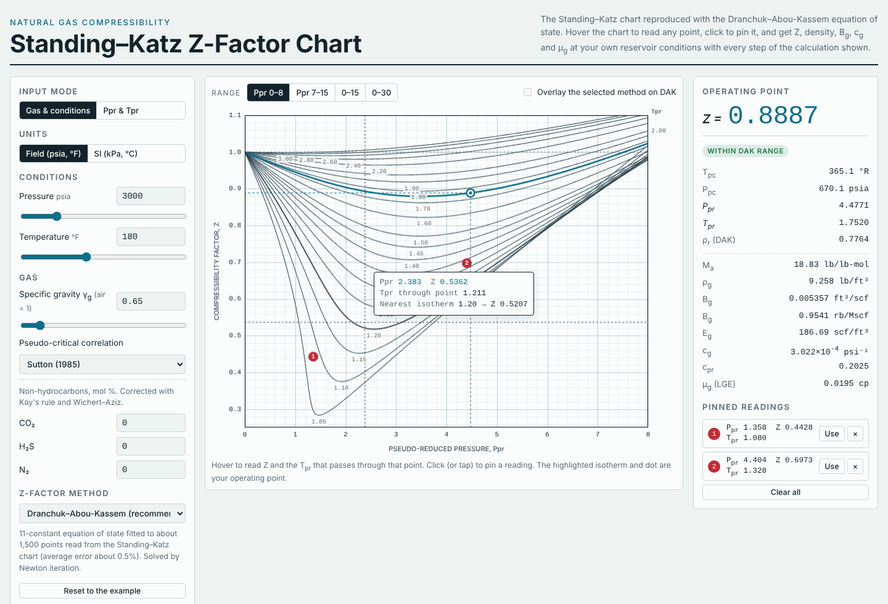

# Standing–Katz Z-Factor Chart (Petroleum Fluid Properties)

An interactive, calculation-backed version of the Standing–Katz natural-gas compressibility chart, for petroleum engineering coursework and quick reservoir-engineering checks.

▶ **Open it:** https://kendrewflor.github.io/standing-katz-chart/



## What it does

- **Reproduces the chart.** The 20 isotherms (T<sub>pr</sub> 1.05 to 3.0) are calculated with the Dranchuk–Abou-Kassem equation of state, which was fitted to the original Standing–Katz chart. View P<sub>pr</sub> 0–8 or 7–15 (the two panels of the printed chart), 0–15, or out to 30.
- **Lets you read it.** Hover anywhere to get P<sub>pr</sub>, Z, the exact T<sub>pr</sub> passing through that point and the nearest isotherm. Click to pin readings; send any pin back as the operating point.
- **Works from your gas.** Enter gas gravity, pressure and temperature (field or SI units) and the CO₂, H₂S and N₂ content. Pseudo-critical properties come from Sutton or Standing, with Kay's rule and the Wichert–Aziz sour-gas correction.
- **Gives the gas properties.** Z, density, B<sub>g</sub> (ft³/scf and rb/Mscf), E<sub>g</sub>, isothermal compressibility c<sub>g</sub> and viscosity μ<sub>g</sub> (Lee–Gonzalez–Eakin).
- **Shows the work.** Every step is written out with the numbers filled in, down to each Newton iteration of the Z solution.
- **Compares methods.** Dranchuk–Abou-Kassem, Hall–Yarborough, Brill–Beggs and Papay side by side, with each method's usual range flagged. You can overlay any of them on the chart.
- **Exports.** An isotherm table (Z, B<sub>g</sub>, ρ<sub>g</sub>, c<sub>g</sub>, μ<sub>g</sub> against pressure) that copies as CSV for Excel.

The equations, ranges and references are in [docs/METHOD.md](docs/METHOD.md).

## Accuracy

The Dranchuk–Abou-Kassem fit reproduces the printed chart with an average error of about 0.5%. Hall–Yarborough agrees with it to within 1% for T<sub>pr</sub> ≥ 1.3. Close to the critical point (T<sub>pr</sub> 1.05–1.2, P<sub>pr</sub> around 1–3) every correlation, and the hand-read chart itself, is least certain, and the methods can differ by several percent or more. The chart is for sweet, lean natural gas: use the CO₂/H₂S/N₂ inputs for anything else, and laboratory PVT data for final design numbers.

## How it's checked

The browser code (`js/`) and an independent Python implementation (`python/zfactor.py`) of the same published equations are tested against each other on every push. The Python side writes a reference table, and the JavaScript has to match it to 10⁻⁷.

```sh
python3 tools/security_scan.py                    # security checks
python3 python/zfactor.py --check                 # reference table is current
python3 -m unittest discover -s tests/python -v   # Python tests
node --test tests/js/zmath.test.mjs               # browser code matches Python
python3 python/zfactor.py 2.0 1.5                 # Z at Ppr 2.0, Tpr 1.5 by every method
```

To run the page locally, open `index.html` in a browser. There is no build step and nothing to install.

## Security

No dependencies, no third-party scripts, styles or fonts, a strict Content-Security-Policy, no network calls, and every GitHub Action pinned to a commit SHA. See [SECURITY.md](SECURITY.md).

## Licence

MIT © 2026 Kendrew Flor S. Arrabe
